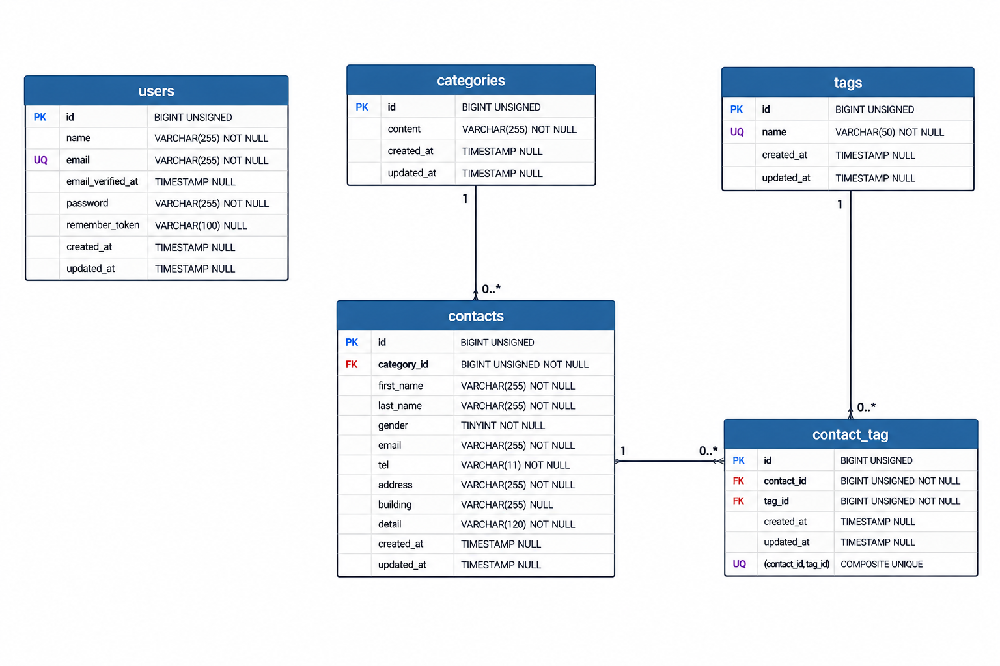

# お問い合わせフォーム

## 1. プロジェクト名

COACHTECH お問い合わせフォーム

## 2. 概要

ユーザーからのお問い合わせを受け付け、管理者が管理画面で内容を確認したり、検索・編集したりできるWebアプリケーションです。

### 主な機能

**お問い合わせフォーム**
- お問い合わせ内容の入力
- 入力内容の確認
- お問い合わせの送信
- 送信完了画面の表示

**管理画面**
- 管理者の新規登録・ログイン・ログアウト
- お問い合わせ一覧の表示
- 名前やメールアドレスなどによる検索
- 性別・お問い合わせ種類による絞り込み
- お問い合わせ内容の編集
- CSVファイルの出力
- タグの編集

**公開API**
- お問い合わせ一覧の取得
- お問い合わせ詳細の取得
- お問い合わせの登録
- お問い合わせ情報の更新

## 3. ER図

今回作成したデータベースの構成を以下に示します。



## 3. ER図

今回作成したデータベースの構成を以下に示します。


## 4. 環境構築手順

以下の手順に沿って、開発環境を構築します。

### ① Laravelプロジェクトの作成

今回はLaravel 10.xを使用するため、バージョンを指定してプロジェクトを作成します。

```bash
docker run --rm \
    -u "$(id -u):$(id -g)" \
    -v "$(pwd):/var/www/html" \
    -w /var/www/html \
    -e COMPOSER_CACHE_DIR=/tmp/composer_cache \
    laravelsail/php82-composer:latest \
    composer create-project laravel/laravel:^10.0 contact-form-app
```

※Laravelの最新版がインストールされないように、バージョンを指定しています。

### ② Laravel Sailのインストール

作成したプロジェクトのディレクトリに移動し、Sailをインストールします。

```bash
cd contact-form-app
```

```bash
docker run --rm \
    -u "$(id -u):$(id -g)" \
    -v "$(pwd):/var/www/html" \
    -w /var/www/html \
    -e COMPOSER_CACHE_DIR=/tmp/composer_cache \
    laravelsail/php82-composer:latest \
    composer require laravel/sail --dev
```

続いて、MySQLを使用する設定を追加します。

```bash
docker run --rm \
    -u "$(id -u):$(id -g)" \
    -v "$(pwd):/var/www/html" \
    -w /var/www/html \
    -e COMPOSER_CACHE_DIR=/tmp/composer_cache \
    laravelsail/php82-composer:latest \
    php artisan sail:install --with=mysql
```

※M1/M2/M3 Macを使用している場合、MySQLの起動時にエラーが発生することがあります。その場合は `compose.yaml` のmysqlサービスに以下を追加します。

```yaml
platform: 'linux/amd64'
```

### ③ .envファイルの設定

`.env` ファイルを開き、データベースの接続情報を以下のように設定します。

```env
DB_CONNECTION=mysql
DB_HOST=mysql
DB_PORT=3306
DB_DATABASE=laravel
DB_USERNAME=sail
DB_PASSWORD=password
```

`DB_HOST` は `localhost` ではなく、MySQLコンテナ名の `mysql` を指定します。

### ④ フロントエンドのセットアップ

画面のスタイリングにはTailwind CSSを使用し、JavaScriptの処理にはAlpine.jsを使用します。

まず、Sailコンテナを起動した状態で、必要なパッケージをインストールします。

```bash
./vendor/bin/sail npm install
```

Tailwind CSSなどのパッケージも追加します。

```bash
./vendor/bin/sail npm install -D tailwindcss@^3.4.0 postcss autoprefixer
./vendor/bin/sail npm install alpinejs
```

インストールが終わったら、Tailwind CSSの設定ファイルを作成します。

```bash
./vendor/bin/sail npx tailwindcss init -p
```

`tailwind.config.js` の内容を以下のように変更します。

```javascript
/** @type {import("tailwindcss").Config} */
export default {
  content: [
    "./resources/**/*.blade.php",
    "./resources/**/*.js",
    "./resources/**/*.vue",
  ],
  theme: {
    extend: {},
  },
  plugins: [],
}
```

次に、以下のリポジトリをクローンします。

```bash
git clone https://github.com/coachtech-prepared-file/Preparedblade-ConfirmationTest-ContactForm.git
```

クローンしたリポジトリにある `resources` フォルダを、今回作成したプロジェクトの `resources` フォルダと入れ替えます。

Finderでプロジェクトフォルダを開く場合は、以下のコマンドを使用します。

```bash
open .
```

最後に、Viteの開発サーバーを起動します。

```bash
./vendor/bin/sail npm run dev
```

※開発サーバーは起動したままにしておきます。

### ⑤ phpMyAdminの追加

データベースの中身を確認できるように、phpMyAdminを追加します。

`compose.yaml` を開き、mysqlサービスの後に以下の設定を追加します。

```yaml
phpmyadmin:
    image: 'phpmyadmin:latest'
    ports:
        - '${FORWARD_PHPMYADMIN_PORT:-8080}:80'
    environment:
        PMA_HOST: mysql
        PMA_USER: '${DB_USERNAME}'
        PMA_PASSWORD: '${DB_PASSWORD}'
    networks:
        - sail
    depends_on:
        - mysql
```

### ⑥ Sailの起動とエイリアスの設定

Sailを起動します。

```bash
./vendor/bin/sail up -d
```

毎回 `./vendor/bin/sail` と入力しなくても済むように、エイリアスを設定しておきます。

zshを使用している場合は、以下を実行します。

```bash
echo "alias sail='[ -f sail ] && bash sail || bash vendor/bin/sail'" >> ~/.zshrc
```

bashを使用している場合はこちらです。

```bash
echo "alias sail='[ -f sail ] && bash sail || bash vendor/bin/sail'" >> ~/.bashrc
```

設定を反映するため、以下を実行します。

```bash
exec $SHELL
```

### ⑦ アプリケーションキーの生成

Laravelで使用するアプリケーションキーを生成します。

```bash
sail artisan key:generate
```

### ⑧ データベースの作成

最後に、マイグレーションとシーダーを実行して、テーブルの作成と初期データの登録を行います。

```bash
sail artisan migrate --seed
```

データベースを最初から作り直す場合は、以下のコマンドを使用します。

```bash
sail artisan migrate:fresh --seed
```

### 日本語化・翻訳について

バリデーションのメッセージは、FormRequestの `messages()` を使用して日本語にしています。

認証関連のメッセージについては、`lang/ja` を使用しています。

なお、`laravel-lang/*` 系の外部翻訳パッケージは使用していません。

## 5. 使用技術

| 分類 | 技術 |
|---|---|
| バックエンド | PHP 8.2 / Laravel 10 |
| フロントエンド | HTML / CSS / JavaScript |
| CSSフレームワーク | Tailwind CSS |
| JavaScriptライブラリ | Alpine.js |
| データベース | MySQL 8.0 |
| 開発環境 | Docker / Laravel Sail |
| 認証機能 | Laravel Fortify |
| API | REST API |
| バージョン管理 | Git / GitHub |
| APIテスト | Postman |
| DB管理ツール | phpMyAdmin |

## 6. APIエンドポイント一覧

ベースURL：`http://localhost/api/v1`

| メソッド | パス | 内容 |
|---|---|---|
| GET | `/contacts` | お問い合わせ一覧の取得 |
| GET | `/contacts/{contact}` | お問い合わせ詳細の取得 |
| POST | `/contacts` | お問い合わせの登録 |
| PUT | `/contacts/{contact}` | お問い合わせ情報の更新 |

## 7. 開発環境URL

| 項目 | URL |
|---|---|
| お問い合わせフォーム | http://localhost |
| 管理者登録 | http://localhost/register |
| ログイン | http://localhost/login |
| 管理画面 | http://localhost/admin |
| phpMyAdmin | http://localhost:8080 |

## 8. 作成者

[自分の名前]